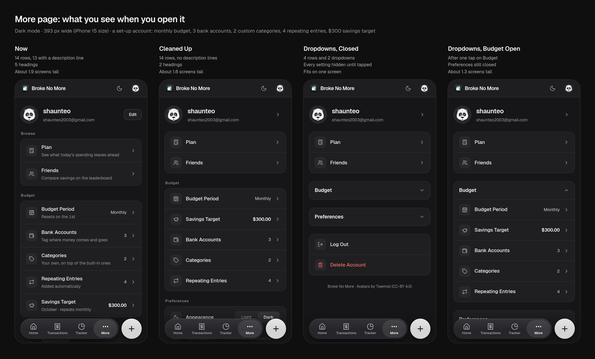
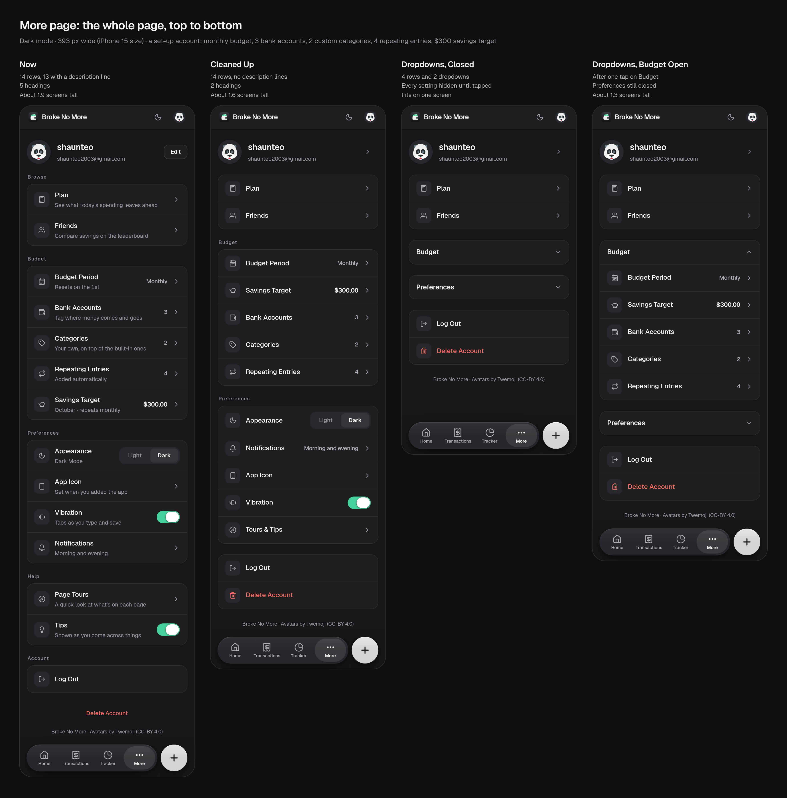
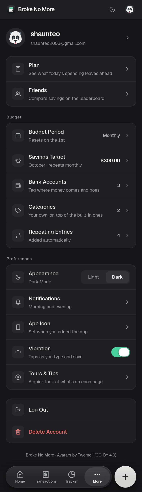
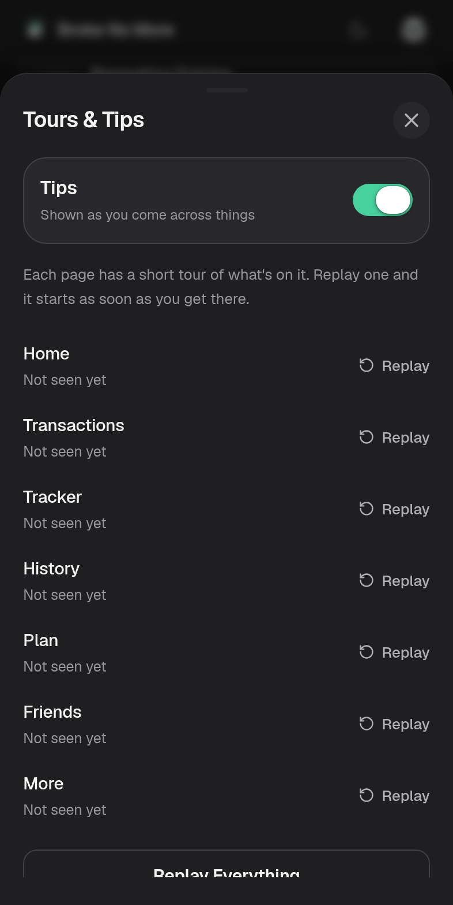

# More page mockups

Mockups for the More page redesign, at iPhone 15 size in dark mode. The data is
an example set-up account: monthly budget, 3 bank accounts, 2 custom
categories, 4 repeating entries and a $300 savings target.

Four versions, left to right:

1. **Now**: the page as it ships today.
2. **Cleaned Up**: one line per row, two headings, and Delete Account under Log Out.
3. **Dropdowns, Closed**: the cleaned-up page with Budget and Preferences collapsed.
4. **Dropdowns, Budget Open**: the same page after one tap on Budget.

## What you see when you open More

## The whole page

Single screenshots of each version are in [`screens/`](screens/).

## As built

The Cleaned Up version, with every row's description kept. These are
screenshots of the real `MorePage` component with the same example data in
place of a backend, at the same size.

 
